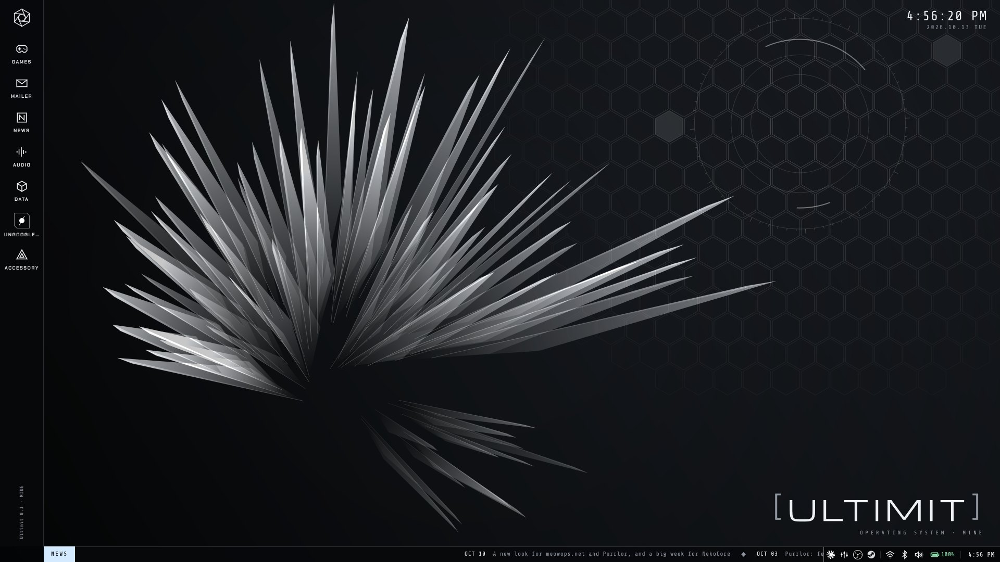
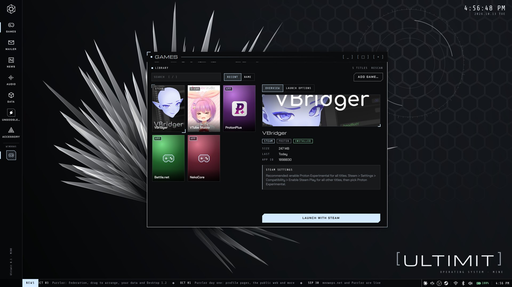
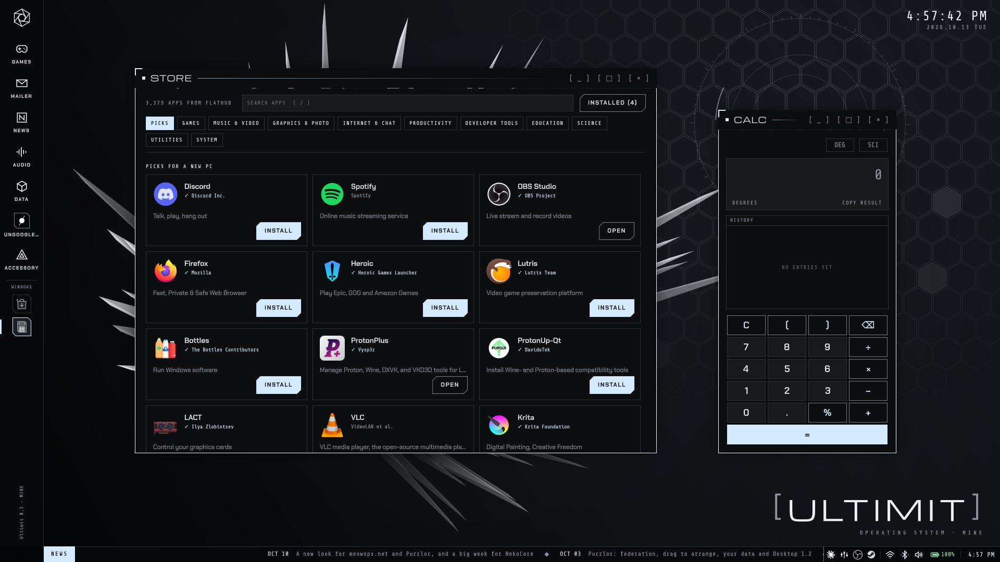
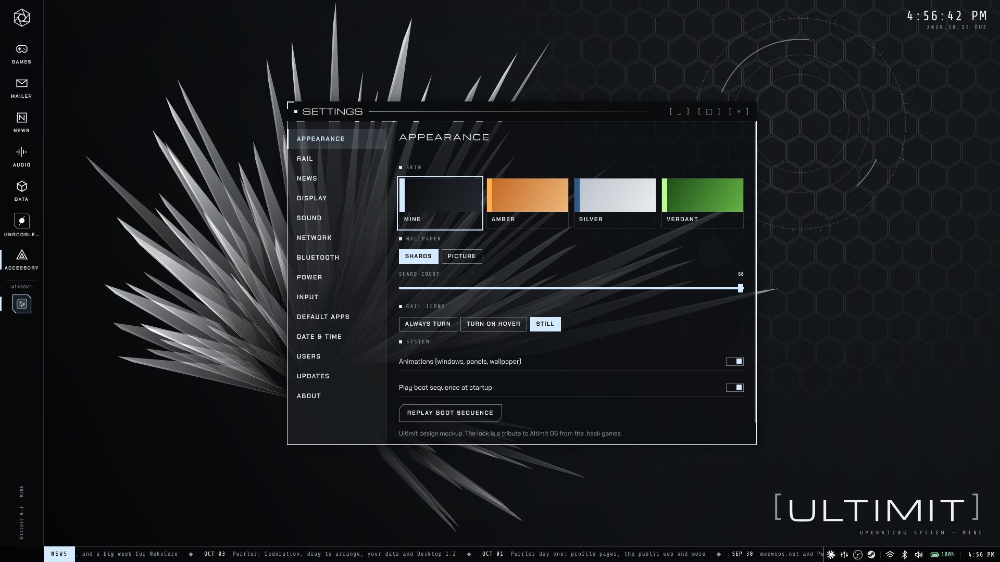
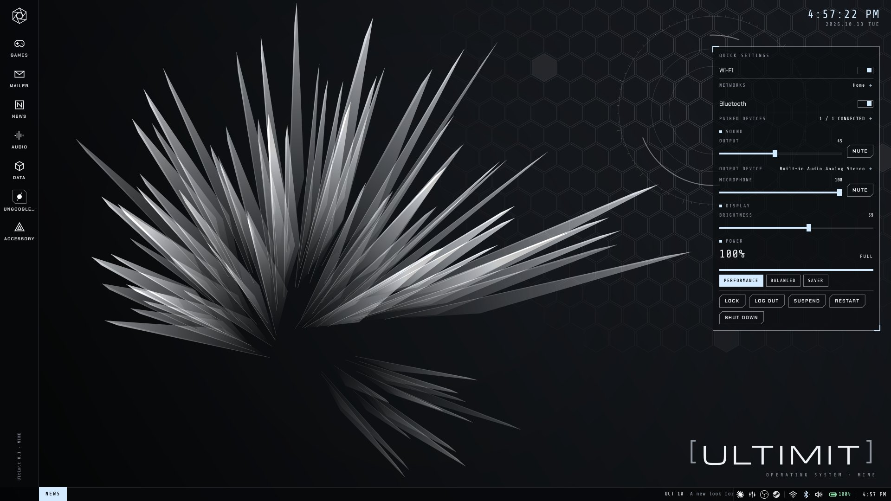
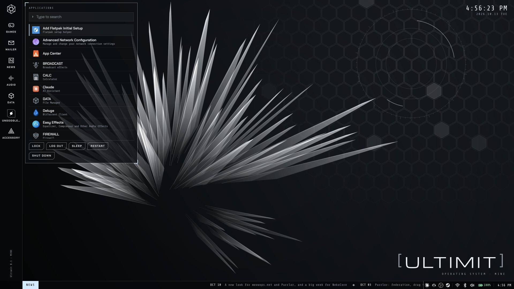
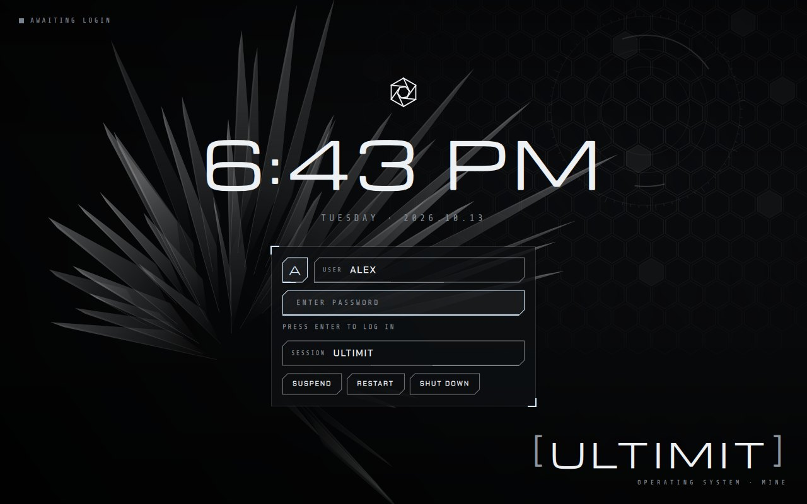

# [ ULTIMIT ]

A gaming-first Linux desktop for people who grew up wishing their computer
looked like Altimit OS from the *.hack* games: a dark icon rail, crystal-shard
wallpapers, hexagon grids, bracketed type and glass windows that open like a
console line drawing itself.

Ultimit is built on Ubuntu 26.04 LTS. It is its own Wayland compositor and
desktop shell, not a theme on top of another desktop.

> Status: 0.1, early. It runs as a daily desktop on the developer's machines; expect rough
> edges, and send a report (Settings › About › Save a report) when you hit one.

| | |
|---|---|
|  |  |
|  |  |
|  |  |

## Goals

1. **Games work without fuss.** Steam and Proton, NVIDIA and hybrid laptops,
   fullscreen direct scanout, VRR and tearing control. A desktop decision that
   costs games frames or latency is the wrong decision.
2. **It looks like nothing else.** The approved design lives in
   [`docs/design/mockup.html`](docs/design/mockup.html). Open it in a browser
   and click around; it is the reference for every screen.
3. **It installs on plain Ubuntu.** Ultimit is a thin layer over a well-supported
   base: Ubuntu's own packages and updates, plus Ultimit in `/opt/ultimit`.

## Install

- **A new PC:** the Ultimit ISO. Boot it from a USB stick, and the Ultimit installer asks a few
  plain questions (Wi-Fi, which drive, your name and password) and installs Ubuntu 26.04 with
  Ultimit: no desktop to remove, the NVIDIA driver when needed. Build it with
  `scripts/build-iso.sh` from a [release](https://github.com/m0nnnna/ultimit/releases); see
  [`docs/iso.md`](docs/iso.md).

> **Keeping Windows? Shrink it in Windows first.** The installer puts Ultimit in free space
> next to Windows and never resizes Windows itself. Before booting the USB stick: Windows' Disk
> Management › right-click **(C:)** › **Shrink Volume** by 50 GB or more, leave the space
> unallocated, and turn off Fast Startup. Details: [`docs/iso.md`](docs/iso.md#keeping-windows-dual-boot-shrink-windows-first).

- **An existing Ubuntu 26.04:** clone this repository and run `scripts/install.sh`. It builds
  Ultimit into `/opt/ultimit` for every user and replaces GNOME (`--keep-gnome` keeps it); see
  [`docs/install.md`](docs/install.md).

## Updates

Ubuntu's packages update the Ubuntu way. Ultimit updates from this repository's
[releases](https://github.com/m0nnnna/ultimit/releases): the desktop says when a new one is
out, and Settings › Updates installs it. See [`docs/updates.md`](docs/updates.md).

## Layout

| Path | What lives there |
|---|---|
| `docs/design/` | The interactive design mockup |
| `docs/architecture.md` | Stack choices and why |
| `docs/install.md` | Installing on another computer, updating, removing |
| `docs/iso.md` | The Ultimit ISO: Ubuntu's server installer, patched to set up Ultimit |
| `docs/updates.md` | Updates: Ubuntu's packages the Ubuntu way, Ultimit from GitHub releases; publishing one |
| `scripts/install.sh` | The installer (builds the libraries, installs to `/opt/ultimit`, sets up the login screen) |
| `assets/fonts/` | Michroma, Chakra Petch, Share Tech Mono (SIL Open Font License, licences beside them) |

## Credits

The look is a tribute to Altimit OS from *.hack* by CyberConnect2 and
Bandai Namco. Ultimit is an unofficial fan project. Its emblem, wallpapers and
code are original.

Successor to [nekOS](https://github.com/m0nnnna/nekos).

## License

MIT. See [LICENSE](LICENSE).
